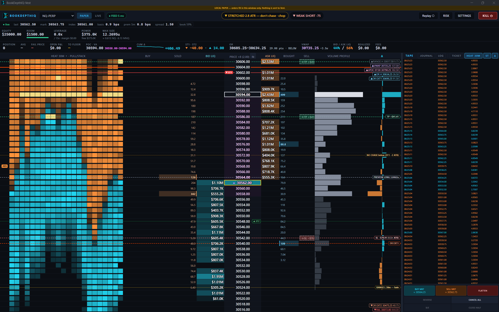

# BookDepthIQ-Vest

A depth-ladder (DOM) scalping panel for **[Vest Markets](https://vestmarkets.com)** perps, starting
with NQ. It runs as a Chrome extension next to your logged-in Vest tab. You get a price ladder with
live Vest book, tape and volume, one-click market, limit and scale entries with TP/SL brackets (up
to three partial targets), $-risk sizing, a stop and targets you can preview on the ladder before
you enter, trade management (B/E, trailing stop on R or SuperTrend, close half) and one-key
flatten. **New since 1.4: see [What's new](#whats-new).**

**Companion:** [Vest Liquidity Scanner](https://github.com/autopilotaitech/BookDepthIQ-Vest-Scanner)
ranks all of Vest's markets by real trading, volatility and trend vs chop, so you know which one to
open in this panel. Read-only, separate install. Clicking a scanner row switches this panel to
that market (through a `#bdiq-switch` marker on the Vest link it opens; nothing but the instrument
changes, and held stops disarm as on any switch).



> ## ⚠️ BETA — read this before you trade
>
> - **It works, and it is still beta.** Every LIVE action has been in real use on Vest since
>   2026-10-08: market entries, ladder limit orders, order drag, TP/SL drag, B/E, FLATTEN and
>   CANCEL ALL. Beta means it hasn't been tested on many accounts or setups yet. Confirm your
>   first trades on Vest's own screen.
> - **Vest publishes no trading API.** The panel sends the same requests Vest's own web app sends,
>   using your existing login. If Vest changes its app, things can break without warning. Watch the
>   result bar under the LIVE banner and keep Vest's own tab open to confirm every order.
> - **Prop-account terms are your responsibility.** Vest's Prop Terms treat API access as a feature
>   Vest controls and allow one account per person. Using a third-party panel may be treated as
>   unauthorized use. Read the terms and decide for yourself.
> - **Manual trading only.** The panel has no algos, no auto-entry and no copier. Nothing OPENS a
>   position without your click, an armed hotkey or a stop you armed yourself. A few management
>   features you can turn on (B/E after TP1, trailing stop, stop guard, close at your daily loss
>   limit, close before the weekend lock) move a stop or close a position without a click; all are
>   off by default (see *Safety rules*).
> - Not financial advice. No warranty (MIT). Start with the smallest size Vest allows.

---

## What you need

- Google Chrome (or another Chromium browser that supports Manifest V3 extensions)
- A Vest account you can log into at **https://next.vestmarkets.com**
- [Node.js](https://nodejs.org) 20 or newer, to build the extension once

## Install

**Easy way (no Node needed):**

1. Download the latest `BookDepthIQ-Vest-vX.Y.Z.zip` from
   [**Releases**](https://github.com/autopilotaitech/BookDepthIQ-Vest/releases/latest).
2. Unzip it to a folder you'll keep, for example `C:\BookDepthIQ-Vest`.
3. Open `chrome://extensions` and turn on **Developer mode** (top right).
4. Click **Load unpacked** and pick the unzipped folder.
5. Pin the **BookDepthIQ-Vest** icon in the toolbar.

**To update:** download the new zip, unzip it over the same folder, press reload on the extension
in `chrome://extensions`, then reopen the panel.

**From source:**

```bash
git clone https://github.com/autopilotaitech/BookDepthIQ-Vest.git
cd BookDepthIQ-Vest
npm install
npm run build        # creates dist/ — load this folder with "Load unpacked"
```

## First run: PAPER

1. Click the toolbar icon. The panel opens in its own window.
2. It always starts in **PAPER**. Orders fill locally in this window and nothing goes to Vest.
   The banner says so.
3. Pick a market (NQ-PERP by default) and learn the ladder in PAPER first.

## Going LIVE

1. Open **https://next.vestmarkets.com** in the **same Chrome** as the panel and log in.
   **Keep only one Vest tab open** (see Troubleshooting).
2. Open the panel and wait a few seconds. The red **"no Vest login"** text next to the switch
   should disappear.
3. Press **LIVE**. The panel reads your Vest account and asks:
   *"LIVE: orders go to &lt;account&gt;. Continue?"*
4. The banner turns red: **LIVE — &lt;account&gt; — real orders**. The account row shows your Vest
   balance, the fail floor (`max_drawdown_limit`), leverage, trading power and sync status.

Every LIVE launch starts in PAPER again. LIVE is never remembered.

## Using the ladder

| Action | PAPER | LIVE (real orders on Vest) |
|---|---|---|
| **BUY MKT / SELL MKT** buttons | market fill | market order, with TP/SL legs if BRACKET is on |
| Click the **BUY** / **SELL** column at a price | limit order | **limit order** (GTC) with TP/SL legs at your points from that price |
| Click with **SCALE ON** | 2–10 limits | **scale order** like Vest's own: the first limit opens, the rest are added to the same position (no TP/SL) |
| **Shift+click** the BUY / SELL column | stop order | **panel-held stop**: a buy stop above the ask or sell stop below the bid. When a trade prints at or through it (or, with **STP 1m CLOSE**, when a one-minute bar closes at or through it), the panel sends a **market** entry with your TP/SL (dashed STP chip; click to cancel, drag to move) |
| Click an **LMT** chip | cancel | cancel on Vest |
| Drag an **LMT** chip to another row | move | move on Vest (cancel, then re-place the unfilled size at the new price; TP/SL shift with it) |
| Drag a **TP** / **SL** chip | move the leg | move the leg on Vest (each partial target on its own) |
| Drag a **◇** preview stop / target | change your stop / target distance | same — nothing is sent |
| **B/E** | stop to entry ± offset | moves (or adds) the Vest stop |
| **CLOSE HALF** | half at market | half at market on Vest (never blocked) |
| **FLATTEN** / **F** | close all | closes the Vest position, then cancels its resting orders |
| **CANCEL ALL** / **Esc** | cancel all | cancels every resting Vest order on the symbol |
| REVERSE / adding to an open position | yes | not yet (paper only) |

**Reading the ladder** (columns, left to right)

| Column | Shows |
|---|---|
| **Buy / Sell** | where you click to place limits; your order and TP/SL chips |
| **Sold / Bought** | footprint: volume that hit the bid / lifted the ask at each price. A cell lights up when one side outweighs the other diagonally by the imbalance ratio (default 3:1, in settings); a white edge marks 3+ in a row (stacked) |
| **Bid liq / Ask liq** | resting size as heat; **WALL** = at least 3× the average level |
| **Price** | value area tinted, POC outlined, last trade and your average marked |
| **Volume profile** | session volume per price, split orange (sold) / cyan (bought); POC outlined, value area bright, with POC / VAH / VAL labels |
| **Δ** | bought − sold at each price (click the header to hide) |

The position strip also shows **points to your fail floor**, POC and value area, the session
cumulative delta with a sparkline, and the bid/ask split of visible liquidity. Volume, footprint
and delta count from when the panel opens.

**Dual SuperTrend** (same engine and settings as BookDepthIQ)
- **ST1** (solid line, 60 s candles, 10, ×3.6) and **ST2** (dashed, 15 s candles, 10, ×3.0) are
  drawn across the ladder at their price, green when the line is support below price, red when it
  is resistance above, with ▲ ST1 / ▼ ST2 tags on the price column. Off-screen they pin to the
  ladder edge with the distance in points.
- They update at each candle close: the line only ratchets with the trend and flips when a candle
  closes through it **and** that candle's delta agrees.
- The header badge shows the combined state (▲▲ STRONG LONG … ▼▼ STRONG SHORT) and confidence,
  and pulses on a flip. The strip shows points from price to each line. Toggle with **ST** in the
  tape header. On open it loads the last ~45 minutes of Vest trades ("SuperTrend loading 45
  min…"), so ST1, ST2 and the market state are right from the start instead of after 10+ minutes.

**VWAP, imbalances and big trades** (settings → *Indicators*, saved per instrument)
- **VWAP** with σ bands (default 1 and 2), anchored to your session **start/stop time** and time
  zone (default 09:30–16:00 New York). On open the panel pages in that session's trades from
  Vest, so VWAP is right even if you open the panel late. Drawn as a purple line with dashed band
  lines; the strip shows VWAP and how many σ price is from it.
- **Footprint imbalances:** ratio, minimum volume (% of the busiest row), stack size, and
  **zone lines** for stacked imbalances (▲ support at the bottom of a buy run, ▼ resistance at the
  top of a sell run). Turn the whole thing off per instrument.
- **Big trades (tape only):** prints at or above your size (default 8u ≈ the top 1% of Vest NQ
  prints) flash when they hit and stay highlighted on the tape: bold, tinted by side with a side
  edge, a size bar and "B 12.40" / "S 9.80". At 3× your size they are larger and stronger.

**RTH opening range** (NQ and ES only — the same PAXOR logic as BookDepthIQ)
- **OR H / OR L** from the trades in the first 30 seconds after the 08:30:00 Chicago bell, drawn
  as solid lines (blue high, red-orange low); dashed and marked "forming" during those 30 s.
- **EXT rungs** every 65 pts on NQ / 15 pts on ES beyond the range; each time price breaks the
  outermost rung the next one appears (EXT1, EXT2, …). Optional mid line.
- Like BookDepthIQ's engine, the range stays up until the next weekday bell (Friday's carries to
  Monday) and the EXT ladder keeps growing until then. Opening the panel late is fine: it pages in
  the bell window and every trade since from Vest (a busy day can take a few seconds). The strip shows the range, its size in points, and whether price is above, inside or
  below it. Settings → Indicators → RTH opening range (shown only on NQ and ES).

**Funding** (Vest settles funding hourly, on the index notional)
- The position strip shows Vest's current **hourly rate** and its yearly equivalent, **who pays**
  (positive: longs pay shorts), minutes to the next settlement, your **$ per hour** for the
  position you hold (red in the last 5 minutes if you are about to pay), and a **predicted** rate:
  this hour's average premium put through Vest's published formula.
- **prem 5m** in the header is the live premium the way Vest measures it (impact prices for a
  $100 ÷ initial-margin order vs the index). NQ/ES/RTY trades are blocked beyond ±25 bps of the
  index (BTC/ETH ±50), so it turns amber near the band, where price tends to snap back.
- For a scalp, funding is small: NQ at the ±25 bps limit is ≈ 0.005% an hour (≈ $0.16 on 0.1 units)
  and nothing if you are flat at the top of the hour.

**Cost panel** (above the buttons): what an entry really costs, before you click
- **Spread light:** green **CHEAP** = the spread is at or below this market's median for the last
  5 min, amber = normal, red **WIDE** = above its p90 (wait, or use a limit). It shows
  "learning…" for the first few minutes.
- **BUY ≈ / SELL ≈:** your fill price for the current size, worked out from the live book. Amber
  **slip** means your size reaches past the best price. The estimate also shows on the BUY MKT /
  SELL MKT buttons.
- **Break-even:** points price must move your way to cover the spread both ways, any slippage and
  both taker fees, plus its $ and share of your drawdown room.
- **TP = N× cost:** your TP distance divided by break-even. Under 2× (amber/red) the trade mostly
  pays the spread.

**Sizing and brackets** (bottom bar)
- **Size** can be in units, USD notional (like Vest's own ticket) or $ risk at the stop. The
  equivalent CME contracts, notional, leverage and round-trip cost are shown underneath.
- **TP pts / SL pts**: distances in points. They're your numbers; the panel has no built-in
  defaults. 0 means no leg. **BRACKET ON/OFF** toggles legs for new entries.
- **B/E + pts**: the offset used by B/E.
- **TP2 / TP3** (second row): more targets, each further than the last. With two or more set,
  **split** (e.g. `50/30/20`) says what share of the size each one closes, and the ticket shows the
  units and $ per target. **B/E after TP1** moves your stop to entry ± the B/E offset once TP1
  fills (see *Safety rules*).
- **SCALE ON**: a ladder click places 2–10 limits from the clicked price, **over pts** further
  away from the market, sized evenly or with a **skew** toward the start or the end, like Vest's
  own Scale ticket. Shift-click is still a stop. Scale orders carry no TP/SL (Vest's don't either):
  press B/E once filled.

- **Risk buttons** ($25 / $50 / $100 / $200, editable in settings) size the trade so a stop-out
  costs that much, **taker fees both ways included**. $ risk sizing always counts the fees.
- **STOP PTS / ATR / SWING**: in ATR mode the stop is the ATR of the 60 s candles (the ST1 engine)
  × your multiple. In SWING mode a long's stop goes under the low of the last N minutes and a
  short's over the high, plus your buffer, so it sits beyond the structure, and never closer than
  your **≥ min** (0 = no floor; an entry right at the high/low would otherwise get a stop inside
  the noise). The ticket shows both sides (**L x / S y pts**) and, in $ risk sizing, both sizes. In both modes the targets are R
  multiples of the stop and the size follows it, so the $ risk stays the same.
- **STP TOUCH / 1m CLOSE** (TOUCH by default): stop entries (shift-click) fire on the first trade
  through the price, or, with 1m CLOSE, only once a one-minute bar closes through it, so a spike
  that pokes through and comes back doesn't fill you on a false break.
- **setup** tags the next trade (edge fade, breakout, pullback, trend…) for the journal.
- **PREVIEW LONG / SHORT** shows the stop and targets (◇, dashed) on the ladder before you enter,
  with their $. Nothing is sent. Drag the ◇ stop to change it: in $ risk sizing the size follows, so
  the risk stays the same. In ATR mode **snap back** returns to ATR × multiple.
- **CLOSE HALF** closes half the position at market. Like FLATTEN, it is never blocked. Partial
  targets shrink from the furthest one.
- **trail** (from 1R / 1.5R / 2R): once price is that far in your favour, the stop follows the best
  price one risk behind and only moves your way. Picking a trail while you are already in a trade
  applies it to that position at once; **off** ends it. **on ST1 / on ST2**: the stop sits on that
  SuperTrend line while the line is on your side (under a long, over a short), and never moves
  back; a flipped line leaves the stop where it is. **stop guard** (LIVE): if a Vest position loses
  its stop, the panel puts it back at the last price and shows a red warning.
- **Protect my day** (settings; all off by default): a daily loss limit (with *also close open
  trades*), max trades per day, a cooldown after a loss, and *close before the weekend lock*. The
  day starts 17:00 Chicago. When the room left is smaller than your usual risk, **size to fit**
  offers the size that fits. The header shows **day $ / limit · trades** and **LOCKED** when entries
  are locked. Exits are never locked.

**In a trade.** A bar under the position row puts the stop, your entry, the price now and every
target on one line, with the $ at each, and **worst case now** (what the stop costs if it fills,
exit fee included; with no stop, the room left to the fail floor). On the ladder the same stop,
entry, targets and trailing line are drawn across the rows with their $ (dashed while
previewing). The **fit** button in the price header widens the rows so all of them are on screen;
leave it off when placing orders, because wide rows place at the row's price. In LIVE, a **room to
floor** bar under the account row shows how much of the drawdown allowance is left (amber under
50%, red under 25%).

**Hotkeys**
- **F** = flatten and **Esc** = cancel all. Both always work.
- **B** buy, **S** sell, **E** B/E and **R** reverse work only while **HOTKEYS ARMED** is on. Click
  the toggle to arm them.
- **Space** re-centres the ladder. Otherwise the ladder holds still and re-centres only when price
  drifts a sixth of the screen from the middle. While your mouse is over the ladder it doesn't move
  at all (unless price nears the edge), so the row you aim at stays put.
- Wheel over the PRICE column changes the price grouping: 1, 2, 4, 8, 20, 40 or 100 ticks per row.

**Market state** (header, next to the SuperTrend badge), read from price, not SuperTrend flips:
**TREND ▲ / ▼** when the last 15 minutes went one way efficiently (net move ÷ path ≥ 0.3) and far
(≥ 3 ATR of the 1-minute bars), held until it clearly fades; **CHOP — fade the edges** otherwise,
with the last 30 minutes' **RANGE H / RANGE L** drawn on the ladder (pinned at the edge
when off-screen); **EXTENDED, don't
chase** when price is 2σ+ from VWAP or 3+ ATR from ST1. It describes the market; it doesn't call
trades.

**Journal** (the **journal** button top-right, in the Vest tape header next to *ST on* and *hide
log*; click again for the tape): every round trip on the market on screen, with the setup
tag, size, entry, stop, $ result and R, totals and results per setup, and **copy CSV**. PAPER
results are exact (fees in); LIVE ones are the last marked P&L (≈). Kept in this browser.

**Risk calculator (v1.9)**: the **RISK** button in the header opens it over the panel. It reads
your account (LIVE: balance, fail floor and per-market leverage from Vest; PAPER: the paper
account) and Vest's live prices. It never sends an order.
- Pick any market (filters: **Futures** NQ ES YM RTY GC SI HG PL CL BZ NG, **Crypto**, **All**),
  Long/Short, and size by **stop + $ risk** (a % of the room left to the fail floor) or by
  **leverage**. Each market's cap is Vest's `1 / initMarginRatio`, capped by your account.
- Shows size (with the CME contract equivalent), leverage used vs cap, $ lost at the stop and won
  at the target after fees, R:R, a **risk map** (target, entry, stop and the price where the
  account fails), **what a move is worth** ($ per point, per 10 points, per 0.1% / 1%, fees), how
  many losers like it the room holds, and a **leverage chart**: points left before the account
  fails at each leverage, with the leverage above which your stop is past the fail line.
- **Every market** table: same account and $ risk, stop at the same % of price — cap, how far a
  max-size position can move before the account fails, size, leverage, $ per point and per 1%.
  Click a row to load it.
- **Instant accounts** work everywhere risk is counted. Account: **Mine** (tagged "Instant $500"
  etc. when its start value and floor match a package), **Instant** ($500 / $5K / $10K / $25K;
  static drawdown $10 / $200 / $400 / $1,000 as listed publicly, 25x) or **Custom**. The Instant
  floor is static, so typing your balance now shows your room (profit adds to it). The paper
  account's settings have the same **Instant** buttons. Check your own Vest screen.
- **Use in DOM** writes the plan into the ticket: size mode **% room @SL** (the $ risk follows your
  room as it changes), SL and TP points, and opens that market if it isn't on screen.
- **My max lev**: over it, the ticket asks for a second click (nothing is blocked). The ticket also
  shows **% of room · losers left**, and an entry whose stop is past the fail line needs a second
  click. With **PREVIEW** on, the FAIL line is on the ladder before you enter.

**Pro tools (v1.8)**
- **Header pills:** **FEED** (green under 2 s since Vest's last message, amber, then red STALE:
  the ladder greys out and new entries are off; exits keep working) and, in LIVE, **VEST** (⚡ push
  with Vest's median answer time for your orders, POLLING, or STALE).
- **KILL ⏻** (or **Ctrl+K**, from anywhere): closes every position on every symbol at market and
  cancels every order, PAPER or LIVE. Never blocked.
- **Order status (LIVE):** each resting order chip says where it is (· ACKED / WORKING), and the
  **blotter** under the ladder lists the last requests: SENT → ACKED → WORKING → FILLED / GONE, or
  REJECTED with Vest's reason, with Vest's answer time. **NO ANSWER** = still waiting after 3 s:
  check Vest before you resend.
- **Fat-finger checks** above the ticket line: size vs your normal (last 20 journal trades), spread,
  distance of a limit/stop from the market (settings: *far from market pts*, 0 = 4 × ATR; *size ×
  normal*), stop inside the spread. Any **!** or **✗** asks for a **second click on the same order
  within 4 s**; the reason shows in the amber bar.
- **Day lock bar:** when Protect my day locks entries, a red bar over the ticket says why and that
  exits still work.
- **heat 5m · pull/stack** column (toggle **heat** in the tape header): resting size at each price
  over the last 5 minutes, one cell per 10 s showing the AVERAGE size over those 10 s (left = older; cyan = it was a bid then, orange = an offer, brighter = more; yellow = a wall, 3× the typical cell), then size **pulled** (− red: left without
  trading) or **stacked** (+ green) over the last minute. **ABSORB bid** = sellers kept hitting that
  bid (at least your big-trade size, and 2× the buying there), more than was showing when they
  started, the level held (no trade below it since) and at least half the size is still there:
  buyers absorbing (a cyan **ABS** badge at the left of the cell). **ABSORB ask** is the same at an offer (orange **ABS**). The market maker's constant re-quoting
  plays no part.
- **Replay:** the panel records the market on screen (book 4×/s, every trade, ticker) into this
  browser, kept 7 days. **Replay ○** in the header lists the recordings; **▶ start** plays one
  through the ladder in PAPER only (LIVE is off; a fresh paper account), with « 1m / 1m », 1–10×
  speed, a position slider with your replay trades as dots, and the replay P&L. **exit replay**
  brings the live market back.
- **Journal execution:** each trade records the price you expected when you clicked, slippage
  (+ = worse), the entry fee, maker/taker and Vest's answer time; the journal shows averages and the
  CSV has the columns.

**The result bar.** Every LIVE action shows its result right under the LIVE banner: green ✓ when
Vest accepted it, red ✗ with the reason when it was refused. The full request/response log is in
the **LIVE LOG** pane. Its **copy** button copies it with your login already blanked out.

## What's new

| Version | What changed |
|---|---|
| 1.9.0 | **RISK** calculator inside the panel (any market, live prices and leverage caps, risk map, leverage chart, every-market table, Use in DOM), **% room @SL** sizing, your own max leverage, fail-line check and preview FAIL line. |
| 1.8.4 | Heatmap logic: 10 s cells are time-averaged (steady instead of random), coloured by the side the price was on then, brightness against the 90th percentile, yellow = wall (3× typical). |
| 1.8.0 | KILL, FEED/VEST health pills, LIVE order status + blotter, fat-finger checks (second click), day-lock bar, heat/pull/stack column, record + replay, execution columns in the journal. |
| 1.7.1 | Swing stop **≥ min** floor; SuperTrend loads 45 min of history on open; RANGE H/L pinned when off-screen. |
| 1.7.0 | **SWING** stop, **STP 1m CLOSE** stop entries, market state (**TREND / CHOP / EXTENDED**) with range lines, trade **journal** with setup tags. Off-screen labels take one line instead of crowding out the ladder. PAPER keeps the stop and targets from the click (an ATR or swing stop no longer changes at the fill). |
| 1.6.5 | The trail menu applies to the position you're already in, not only the next entry. |
| 1.6.4 | Calm ladder: re-centres only when price drifts a sixth of the screen, and holds still under your mouse. |
| 1.6.3 | Trailing stop on SuperTrend: **on ST1** or **on ST2**. |
| 1.6.2 | **fit** button (off by default) instead of always widening the rows. ATR mode warns when there is no stop yet. |
| 1.6.1 | Stop, entry, targets and trail drawn across the ladder with their $. |
| 1.6.0 | $ risk buttons (fees included), ATR stop with targets in R, entry **PREVIEW**, **CLOSE HALF**, worst case now, trailing stop, stop guard, **Protect my day** (daily loss limit, max trades, cooldown, close before the weekend lock). |
| 1.5.0 | Bracket bar in a trade, room-to-floor bar, TP2/TP3 with a size split, B/E after TP1, **SCALE** orders. |

## Safety rules built in

- **FLATTEN and CANCEL are never blocked.** No mode, guard, failed read or expiring login stops them.
- **Entry checks:** the size must fit your trading power, the account must be above its fail
  floor, positions must be freshly synced from Vest, and there must be no position already open on
  the symbol. These are the same limits Vest's own ticket enforces.
- **Optional size cap:** settings → *LIVE size cap*. 0 means off.
- **Panel-held stops** are the only orders that fire without a click. They live in the panel, not
  on Vest: close the window, switch instrument or go to PAPER and they are disarmed (the header
  shows **⚡ N stops armed** while any are live). Each one fires once, through the same checks as a
  click.
- **Other things that act without a click**, each off until you turn it on, and none of them ever
  opens a position: **B/E after TP1** (one stop move when TP1 fills), the **trailing stop**,
  **stop guard**, **close at the daily loss limit** and **close before the weekend lock**. They
  need this window open. B/E after TP1 and the trailing stop disarm like panel-held stops, and on
  FLATTEN or CANCEL ALL.
- **Vest is the source of truth.** Positions, orders and balance come from Vest and are never
  computed locally. Vest pushes account changes over its private socket, and the panel re-reads
  them at once (the account row shows **Vest ⚡ live**). If the push drops, it falls back to
  reading every 1.5 s (**Vest synced (polling)**).
- **Your login stays in memory.** The extension reads the token your Vest tab already uses. It is
  never written to disk, never logged, and never sent anywhere except Vest's own API.

## Troubleshooting

| You see | Do this |
|---|---|
| **"no Vest login — no next.vestmarkets.com tab is open in THIS Chrome…"** | Open Vest and log in in the same Chrome window set (same profile) as the panel. |
| **"no Vest login"** after reloading the extension | Reload the Vest tab once, then wait about 3 s. |
| Login flickers, or LIVE behaves oddly | **Close extra Vest tabs.** Keep one. |
| Pressing LIVE seems to do nothing | Read the red text next to the PAPER/LIVE switch. It says exactly why. |
| An order is refused | Read the red result bar under the LIVE banner. |
| Something looks wrong on Vest | Press **FLATTEN**, check Vest's own screen, then open an issue with the copied LIVE log. |

## Reporting bugs

Open an issue at https://github.com/autopilotaitech/BookDepthIQ-Vest/issues with:
- what you clicked and what you expected
- the **copied LIVE LOG** (your login is already blanked out, but read it before posting)
- a screenshot of the panel and of Vest's screen

## Contributing

Feedback, ideas and pull requests are welcome. See [CONTRIBUTING.md](CONTRIBUTING.md) for setup and
the rules for anything that touches LIVE trading. Parked ideas are in [docs/TODO.md](docs/TODO.md).

## For developers

```bash
npm test             # unit tests (request bodies, guards, flatten-always-works, readers)
npm run typecheck
npm run build        # then reload the unpacked extension to try a change (Vest's API refuses
                     # requests from localhost, so `npm run dev` can't load market data)
npm run probe -- NQ-PERP 60   # measure the live Vest book for 60 s
```

Design notes are in [`docs/DESIGN.md`](docs/DESIGN.md), and the LIVE request shapes and safety
rules are in [`docs/LIVE-ORDERS-SPEC.md`](docs/LIVE-ORDERS-SPEC.md). All Vest request bodies live
in one file, `src/vest/tradingShapes.ts`.

## License

MIT. See [LICENSE](LICENSE). Not affiliated with or endorsed by Vest Markets.
